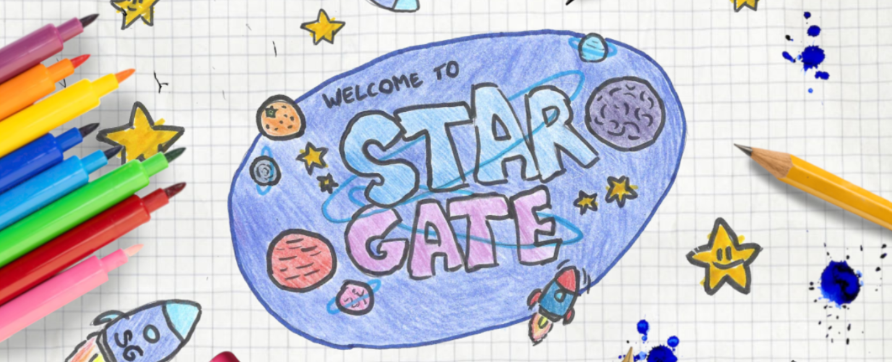
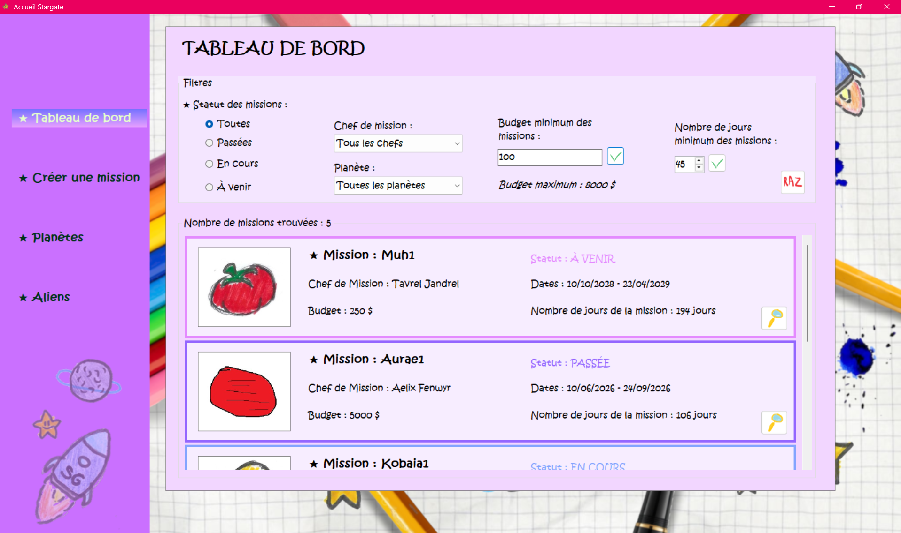
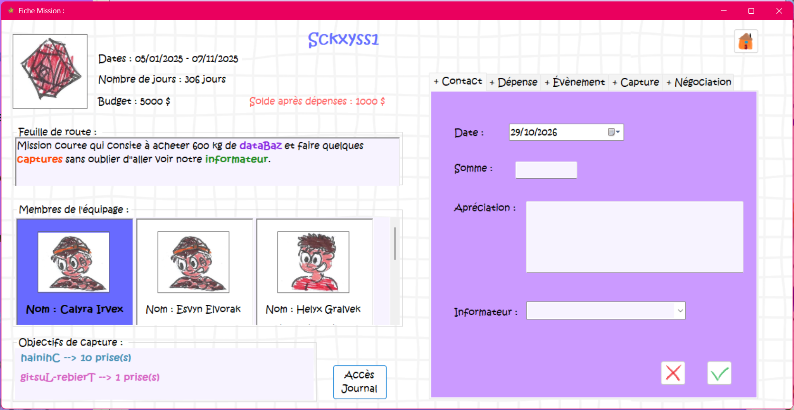
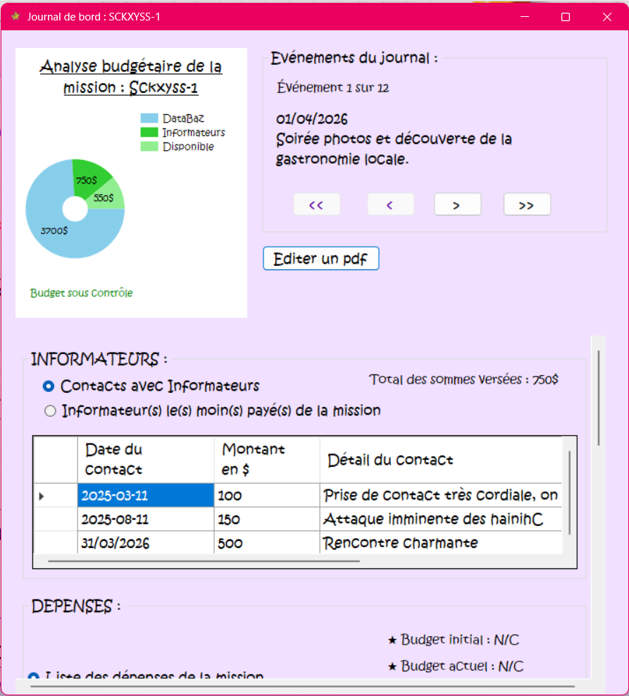
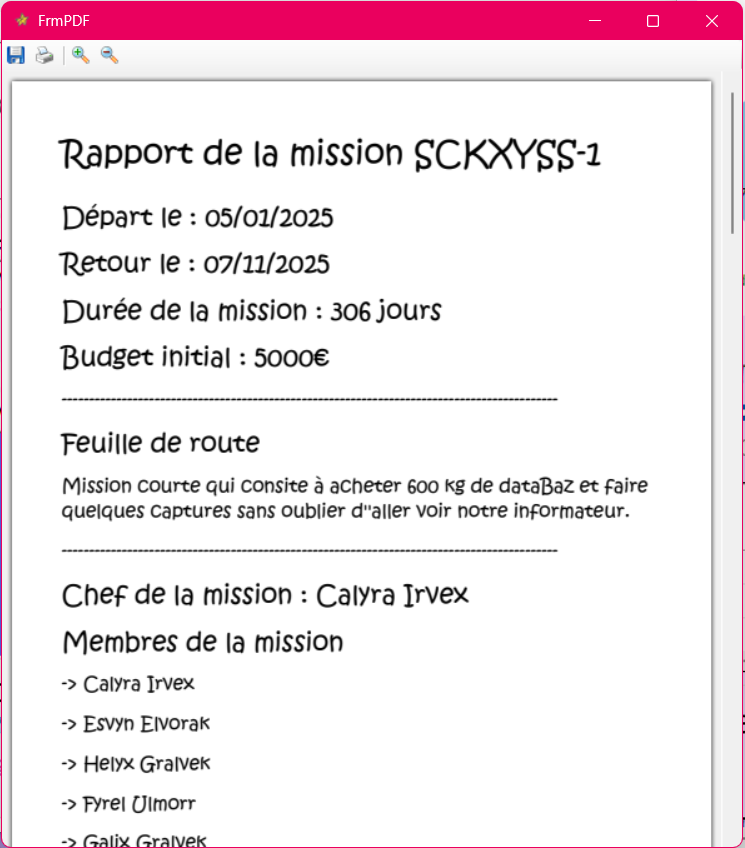
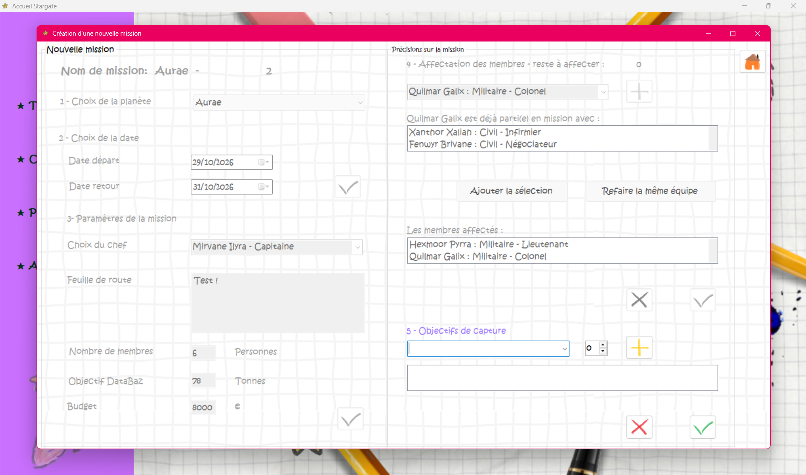
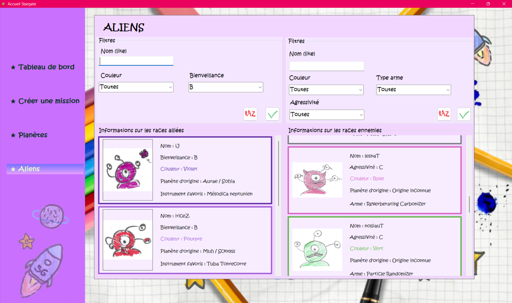
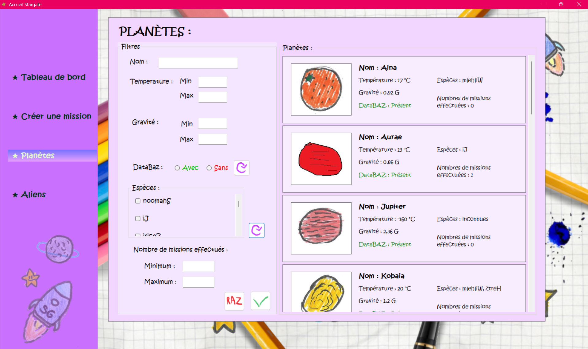

<p align="center">
  
</p>

<h1>Stargate Mission Control</h1>

Stargate Mission Control est une application de bureau réalisée en trinôme dans le cadre d'un projet (BUT Informatique, Université de Strasbourg).

*Une porte des étoiles, des planètes à explorer, des espèces alliées ou hostiles, et un minerai que toute la galaxie s'arrache : le DataBaz. Aux commandes du programme Stargate, à vous de préparer les missions et de ramener vos équipes à bon port…*

## ✧ L'univers

Stargate Mission Control s'inspire de *Stargate*, le film de Roland Emmerich (1994), et surtout de la série *Stargate SG-1* (1997-2007), où une équipe traverse la porte des étoiles pour explorer d'autres planètes. Plus d'informations : [Wikipédia](https://fr.wikipedia.org/wiki/Stargate_SG-1).

## ✧ Le projet

Le sujet, imaginé par nos enseignants, reprend cet univers : chaque mission part vers une planète, avec un équipage, un budget et des objectifs, comme capturer des espèces ennemies ou négocier du DataBaz avec les espèces alliées. L'application permet de préparer ces missions, de suivre leur déroulement et d'en éditer un rapport.

| Contraintes | |
|---|---|
| Durée | 6 semaines (fin avril à mi-juin 2026) |
| Équipe | Trinôme |
| Technologies | C#, Windows Forms (.NET Framework 4.7.2), SQLite, BCrypt.Net, PDFsharp / MigraDoc, PdfiumViewer, Git, Visual Studio |

### Un sujet en sept volets

Le sujet était découpé en sept volets, chacun correspondant à une partie de l'application :

1. Le tableau de bord des missions passées, en cours et à venir
2. La création d'une mission, réservée aux administrateurs
3. Le récapitulatif et la mise à jour d'une mission
4. Le journal de bord, consulté événement par événement
5. Les races répertoriées, alliées et ennemies
6. Les informations sur les planètes
7. Les statistiques

Chaque mission peut aussi être exportée sous forme de rapport PDF.

### Compétences acquises et mises en pratique

- **Interfaces graphiques** : prise en main de Windows Forms et création de composants réutilisables (UserControls)
- **Base de données** : accès à une base SQLite en mode connecté et déconnecté (DataSet, relations entre tables, liaison de données)
- **Sécurité** : sécurisation des requêtes SQL (requêtes paramétrées, transactions) et hachage des mots de passe avec BCrypt
- **Génération de documents** : création d'un rapport de mission en PDF à partir des données
- **Travail en équipe** : développement sur des branches Git séparées, puis fusion du travail de chacun

## ✧ Aperçu

<p align="center">
  <br>
  <em>Tableau de bord des missions, avec filtres</em>
</p>

<details>
  <summary><b>Suivi d'une mission</b> : détail, journal de bord et rapport PDF</summary>
  <br>
  <p align="center">
    <br>
    <em>Détail d'une mission : équipage, budget, objectifs et ajout d'informations</em>
  </p>
  <table>
    <tr>
      <td align="center" width="50%">
        <br>
        <em>Journal de bord et analyse budgétaire</em>
      </td>
      <td align="center" width="50%">
        <br>
        <em>Rapport de mission en PDF</em>
      </td>
    </tr>
  </table>
</details>

<details>
  <summary><b>Création d'une mission</b> (réservée aux administrateurs)</summary>
  <br>
  <p align="center">
    <br>
    <em>Choix de la planète, des dates, du chef, de l'équipage et des objectifs de capture</em>
  </p>
</details>

<details>
  <summary><b>Types d'aliens et planètes</b></summary>
  <br>
  <p align="center">
    <br>
    <em>Aliens alliés et ennemis, avec filtres</em>
  </p>
  <p align="center">
    <br>
    <em>Planètes : température, gravité, DataBaz et espèces présentes</em>
  </p>
</details>

## ✧ Installation et lancement

### Prérequis

- **Windows**
- **Visual Studio 2022** (version récente) ou ultérieure, avec la charge de travail **« Développement .NET Desktop »**
- **.NET Framework 4.7.2**
- La police **Kristen ITC** (fournie avec Microsoft Office). Sans elle, Windows la remplace par une police par défaut.

### Étapes

1. Cloner le dépôt :
   ```bash
   git clone https://github.com/Thalioukill/stargate-mission-control.git
   ```
2. Ouvrir `Projet_Stargate/Projet Stargate.slnx` dans Visual Studio.
3. Restaurer les packages NuGet : clic droit sur la solution → **Restaurer les packages NuGet**.
4. **Fermer puis rouvrir Visual Studio**, puis **Générer → Régénérer la solution**.
   > Cette étape est nécessaire au premier lancement : elle permet de copier la bibliothèque native `SQLite.Interop.dll`. Sans elle, l'application affiche une erreur `DllNotFoundException`.
5. Lancer avec **F5**.

> L'application utilise des chemins relatifs (`../../DataBase`, `../../Images`) : elle doit être lancée depuis Visual Studio (dossier `bin/Debug`).

### Identifiants de démonstration

La création de missions est réservée aux administrateurs :

| Login | Mot de passe |
|---|---|
| `demo` | `salut67` |

## ✧ Structure du projet

```
Projet_Stargate/
├── DataBase/Stargate.db     Base SQLite (données anonymisées)
├── Images/                  Illustrations (aliens, planètes, boutons, fonds d'écran)
├── Connexion.cs             Connexion unique à la base (singleton)
├── mesDatas.cs              DataSet partagé entre les formulaires
├── Form1.cs                 Formulaire d'accueil : tableau de bord, races, planètes
├── FrmLogin.cs              Authentification administrateur
├── FrmMission.cs            Création d'une mission
├── FrmDetailMission.cs      Récapitulatif et mise à jour d'une mission
├── FrmJournalDeBord.cs      Journal de bord, bilan et statistiques
├── FrmPDF.cs                Génération et affichage du rapport PDF
├── FrmDetailPlanete.cs      Détail d'une planète
└── UserControl_*.cs, Info*.cs, …   Composants réutilisables
```

## ✧ Limites connues

Certaines bibliothèques, imposées par le sujet, ne sont pas utilisées dans leur version la plus récente. Leurs mises à jour peuvent en effet modifier leur fonctionnement : par exemple, le passage de PDFsharp et MigraDoc en version 6.5 empêche la génération du rapport PDF. Ces deux bibliothèques sont donc conservées en version 6.2.4.

Il est déconseillé de mettre à jour les packages NuGet sans tester l'application. À terme, ces dépendances pourraient également poser des problèmes de compatibilité.

## ✧ Améliorations possibles

- Améliorer la généricité du code, en regroupant dans des classes communes les méthodes recopiées dans plusieurs formulaires.
- Utiliser des requêtes paramétrées partout, pour protéger toute l'application contre les injections SQL.
- Ne plus dépendre de chemins relatifs, pour pouvoir lancer l'application en dehors de Visual Studio.

## ✧ À propos de l'historique

Le développement a eu lieu sur le GitLab de l'université ; l'historique des commits a été conservé. Avant sa publication ici :

- la **base de données a été retirée de l'historique** et remplacée par une **version anonymisée** (noms, prénoms et dates de naissance des membres remplacés par des valeurs fictives) ;
- le **login de démonstration** a été renommé ;
- les **dépendances NuGet** ont été mises à jour, et deux bugs ont été corrigés (total des dépenses dans le PDF, filtre sur la durée des missions).

## ✧ Équipe

- **Thalia Herzog** — tableau de bord, détail d'une mission, journal de bord, statistiques, interface
- **Yanis Herlin** — authentification, création et édition de mission, illustrations
- **Yann Schwartz** — races, planètes, rapport PDF

Les dessins de l'application (aliens, planètes, personnages, boutons et décors) ont été réalisés à la main par Yanis Herlin.

## ✧ Licence

Ce projet est distribué sous licence **MIT** : voir le fichier [LICENSE](LICENSE).

Le sujet, la structure de la base de données et les classes de départ `Connexion.cs` et `mesDatas.cs` ont été fournis par l'équipe pédagogique de l'IUT Robert Schuman.

*Stargate* est une marque appartenant à ses ayants droit. Ce projet est un travail étudiant **non officiel et non commercial**, sans lien avec les créateurs ou les producteurs de la série.